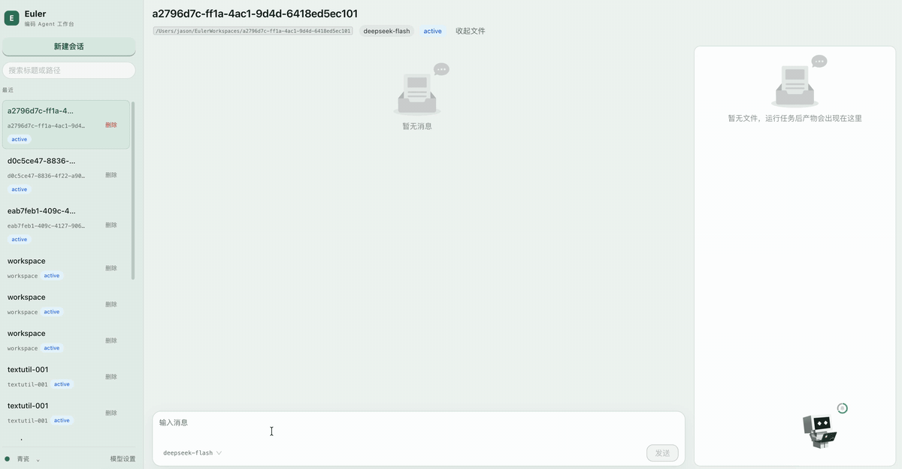

# Euler

Euler 是一个本地优先的编码 Agent 工作台：由 Go 后端、React 控制台和一个可独立运行的一次性 Agent 二进制组成。它既能作为日常编码助手在本地仓库里读写文件、执行命令，也能把同一个 Agent 打包进任务容器，接入 Harbor 做标准化编码评测。

## 演示



上图是一次完整 run 的压缩预览（34 秒）：新建会话并输入任务、Agent 依次执行 `go version`、写入 `main.go` 与 `go.mod`、运行 `gofmt` / `go vet` / `go build` / `go run`，右侧工作区同步列出产物，最后给出任务完成总结。

- [查看高清视频（MP4，H.264 / yuv420p，浏览器与本地播放器均可直接打开）](docs/assets/demo.mp4)
- GIF 仅用于 README 内嵌预览，细节以 MP4 原片为准。

## 核心能力

- **ReAct 编码循环**：基于 Eino 的工具调用循环，支持多轮模型交互、流式输出与显式 `submit` 收尾。
- **可配置预算**：模型轮次、工具调用次数、运行时长、单次工具输出都可设置为硬上限，避免死循环和成本失控。
- **会话与运行管理**：每个会话同时只允许一个活跃 run，完整状态机（`queued` / `running` / `waiting_approval` / `succeeded` / `failed` / `cancelled` / `interrupted`），服务重启后可恢复中断状态。
- **实时事件流**：通过 SSE 推送 run 状态、消息增量与工具调用事件。
- **编码工具集**：`file_list`、`file_read`、`file_search`、`file_write`、`file_patch`、`shell`、`submit`。
- **工作区与文件浏览**：目录树、文件内容预览（带大小限制），run 结束后自动列出新增产物。
- **工作台界面**：工具时间线（命令输出、文件写入 diff、思考过程）、Markdown 与高亮渲染、历史 run 回放，内置石墨 / 纸白 / 青瓷 / 午夜霓虹四套主题。
- **模型配置**：在控制台配置模型与 API Key，密钥可直接用环境变量，不落库、不写日志；支持从 Base URL 拉取可用模型列表。
- **全链路追踪**：可选接入 Langfuse，记录每次模型调用与工具调用。
- **Harbor 评测**：`euler-agent` 二进制直接上传到任务容器内执行，不需要宿主机服务或工作区挂载；内置按难度分组的精选任务清单。

## 文档索引

| 文档 | 说明 |
|---|---|
| [数据结构说明](docs/data-structures.md) | 数据库表、状态机、消息片段、HTTP DTO、SSE 事件载荷与工具输入输出契约 |
| [Agent 工作台设计](docs/superpowers/specs/2026-11-17-euler-agent-workbench-design.md) | 工作台的总体设计与关键取舍 |
| [编码评测设计](docs/superpowers/specs/2026-11-19-euler-coding-eval-design.md) | 编码评测链路与预算设计 |
| [Harbor 集成设计](docs/superpowers/specs/2026-11-19-euler-harbor-integration-design.md) | Harbor 任务、容器执行与结果回传 |

## 架构

```
┌──────────────────────────┐        ┌─────────────────────────────┐
│ web/  React + Vite 控制台 │──HTTP──▶│ cmd/euler  Gin API 服务      │
└──────────────────────────┘  SSE   └──────────────┬──────────────┘
                                                  │
                        ┌─────────────────────────┼─────────────────────────┐
                        ▼                         ▼                         ▼
                 run.Manager              agent.Runtime               持久化 / 追踪
            状态机、并发、取消、恢复      Eino ReAct + 工具 + 模型      SQLite/PG / Langfuse
                                                  │
                                                  ▼
                                        file_* / shell / submit
```

评测链路与在线服务解耦：

```
harbor run ──▶ 任务镜像 ──▶ 上传 euler-agent ──▶ 容器内执行 ──▶ result.json + reward.txt
```

## 目录结构

| 路径 | 说明 |
|---|---|
| `cmd/euler` | HTTP 服务入口，加载配置、迁移数据库、挂载路由 |
| `cmd/euler-agent` | 无数据库的一次性 Agent 入口，供容器内评测使用 |
| `internal/agent` | ReAct 运行时、模型封装、提示词模板、预算控制 |
| `internal/tools` | 文件、shell、submit 等工具实现 |
| `internal/run` | run 状态机、按会话并发控制、取消与启动恢复 |
| `internal/session` | 会话与消息 |
| `internal/workspace` | 工作区与文件浏览 |
| `internal/modelprofile` | 模型配置与密钥存储 |
| `internal/approval` | 审批服务（当前默认自动放行） |
| `internal/event` | 事件存储与 SSE 广播 |
| `internal/config` | 配置文件加载、默认值与校验 |
| `internal/persistence` | GORM 连接、迁移与健康检查 |
| `internal/logging` | 结构化日志 |
| `internal/api` | 路由、本机鉴权、静态资源 |
| `internal/tracing` | Langfuse 追踪 |
| `web/` | React 控制台（Vite + Ant Design + TanStack Query + Zustand） |
| `harbor_eval/` | Harbor Agent、任务清单、筛选脚本与运行结果 |
| `migrations/` | SQL 迁移（按方言分目录：`sqlite/`、`postgres/`） |
| `docs/` | 设计文档、数据结构说明与实现计划 |
| `docs/assets/` | README 演示素材（`demo.mp4` 与内嵌预览 `demo.gif`） |

## 快速开始

### 依赖

**构建与运行必需**：

- Go 1.26+
- Node.js 20+
- Docker 24+（需 compose v2 插件，即 `docker compose` 子命令，不是旧版 `docker-compose`；macOS Docker Desktop 自带，Linux 上需额外安装 `docker-compose-plugin`）
- GNU Make

**开发检查（可选）**：

- `golangci-lint`（`make lint`、提交前检查）

**平台备注**：

`make` target 内部使用 `lsof` / `nohup` / `grep` / `sed` / `awk` / `find` / `kill` 等 Unix 工具。Windows 原生环境（cmd / PowerShell）无法直接执行，需使用 WSL2 / Git Bash / MSYS2，或绕过 make 直接跑 `go run ./cmd/euler` 启动后端、`npm --prefix web run dev` 启动前端。

### 步骤

**1. 启动服务**

```bash
make start
```

自动拉起后端（`http://127.0.0.1:8080`）与前端开发服务器（`http://127.0.0.1:5173`，代理 `/api` 与 `/health` 到后端，热更新）。默认数据库使用 SQLite 单文件（`~/.euler/euler.db`），服务启动时自动执行 `migrations/sqlite/` 下的迁移建表，无需单独启动数据库容器；单独启动后端用 `make dev-api` 即可。如需切换到 PostgreSQL，见下方「多数据库支持」。

**2. 配置模型**

打开控制台 `http://127.0.0.1:5173`，进入「模型配置」页面，填写模型的 Base URL、模型名与 API Key 后保存。Web 控制台的模型配置存在数据库，API Key 也可直接来自环境变量，不落库、不写日志。配好模型后即可创建会话执行任务。

**3. 开始编码**

在控制台新建会话，输入任务描述；Agent 会在工作区读写文件、执行命令，右侧同步展示工具调用与产物。

### 可选配置

通常无需创建配置文件，使用默认值即可。服务默认从用户主目录下的 `.euler/config.yaml` 读取（macOS / Linux 为 `~/.euler/config.yaml`，Windows 为 `%USERPROFILE%\.euler\config.yaml`；不存在则用默认值），也可用 `-config` 参数指定其他路径。`make dev-api` 与 `make dev-restart` 默认使用 SQLite（`~/.euler/euler.db`），无需手工导出；需要指向其他库文件时用环境变量覆盖：

```bash
# macOS / Linux
EULER_DATABASE_URL='/path/to/euler.db' make dev-api
```

```powershell
# Windows PowerShell
$env:EULER_DATABASE_URL='/path/to/euler.db'; make dev-api
```

### 多数据库支持

Euler 的数据库访问基于 `internal/persistence.Dialect` 接口抽象，遵循开闭原则：**新增数据库只需实现接口并在 `init` 中注册，无需修改任何现有文件**。当前内置两种方言：

| 方言 | 驱动 | 迁移目录 | 连接池 | 大小写不敏感 LIKE | 工作区锁 |
|---|---|---|---|---|---|
| `sqlite`（默认） | `glebarez/sqlite`（纯 Go） | `migrations/sqlite/` | 单连接 | `LIKE` | UNIQUE 约束 + 冲突重试 |
| `postgres` | `gorm.io/driver/postgres`（pgx） | `migrations/postgres/` | 多连接 | `ILIKE` | `pg_advisory_xact_lock` |

**切换到 PostgreSQL**：

```bash
# 启动 PG 容器并以后端连 PG 的方式启动服务
make start EULER_DATABASE_DRIVER=postgres

# 或分步：
make dev-db-up EULER_DATABASE_DRIVER=postgres   # docker compose 起 PG
make dev-api   EULER_DATABASE_DRIVER=postgres   # 后端连 PG
```

方言选择优先级：`EULER_DATABASE_DRIVER` 环境变量 > 从 `EULER_DATABASE_URL` 的 scheme 推断（`postgres://` → postgres，否则 sqlite）> 默认 `sqlite`。

**添加新数据库**（如 MySQL）：

1. 新建 `internal/persistence/dialect_mysql.go`，实现 `Dialect` 接口，并在 `init()` 中 `Register("mysql", ...)`；
2. 新建 `migrations/mysql/` 目录，放入该方言的迁移 SQL；
3. 用 `EULER_DATABASE_DRIVER=mysql` 启动即可。

无需修改 `db.go`、`session`、`run` 等任何现有文件。

可选追踪配置：

```bash
# macOS / Linux
export EULER_LANGFUSE_HOST='https://cloud.langfuse.com'
export EULER_LANGFUSE_PUBLIC_KEY='pk-...'
export EULER_LANGFUSE_SECRET_KEY='sk-...'
```

```powershell
# Windows PowerShell
$env:EULER_LANGFUSE_HOST='https://cloud.langfuse.com'
$env:EULER_LANGFUSE_PUBLIC_KEY='pk-...'
$env:EULER_LANGFUSE_SECRET_KEY='sk-...'
```

未配置上述变量则不追踪。E2E 使用独立的配置文件与变量，不会上传追踪数据。启动日志出现 `langfuse tracing enabled` 表示生效。

### 常用命令

```bash
# 一键启动：数据库 + 后端 8080 + 前端 5173
make start

# 一键停止：前端、后端、数据库
make stop

# 重新构建前后端并重启三者
make restart

# 后端（默认 127.0.0.1:8080）
make dev-api

# 改完后端代码后重启后端
make dev-restart

# 前后端一起重启：后端 8080 + 前端开发服务器 5173
make dev-restart-all

# 改完前端代码后使用：重新构建嵌入产物再重启后端（不走 5173 时用这个）
make dev-reload

# 只启动前端开发服务器（127.0.0.1:5173，代理 /api 与 /health 到 8080，热更新）
make dev-web
```

### 生产构建

生产构建会把前端产物嵌入 Go 二进制：

```bash
# macOS / Linux
make build
./bin/euler
```

```powershell
# Windows
make build
.\bin\euler.exe
```

### 常用检查

```bash
make test      # go test ./...（含 internal/api 的 API 测试）
make lint      # golangci-lint run --timeout=5m ./...
make web-test  # 前端单测
make test-e2e  # Playwright 端到端测试
```

## 配置参考（可选）

仅在需要覆盖内置默认值时，才创建用户主目录下的 `.euler/config.yaml`（或用 `-config` 指定其他文件）。支持以下字段（均可省略）：

| 字段 | 默认值 | 说明 |
|---|---|---|
| `listen` | `127.0.0.1:8080` | 仅允许 loopback 地址 |
| `workspace_root` | 用户主目录下的 `EulerWorkspaces` | 工作区根目录 |
| `allowed_origins` | 空 | 额外允许的 Origin |
| `agent.max_model_rounds` | `0` | 模型轮次上限，`0` 表示不限制 |
| `agent.max_tool_calls` | `0` | 工具调用次数上限，`0` 表示不限制 |
| `agent.max_duration` | `10m` | 单次 run 时长上限 |
| `agent.max_output_bytes` | `65536` | 输出上限 |
| `shell_timeout` | `2m` | 单条 shell 命令超时 |
| `shell_output_bytes` | `1MiB` | 单条命令输出上限 |
| `shell_path_prefix` | 空 | 注入到 PATH 最前的目录 |
| `model_timeout` | `10s` | 单次模型请求的空闲超时 |
| `model_request_timeout` | `5m` | 单次模型请求的总时长上限 |
| `model_reasoning_effort` | 空 | `low` / `medium` / `high` / `max` |
| `system_prompt_template` | `coding` | 提示词模板名 |
| `preview_bytes` | `1MiB` | 文件预览上限 |
| `langfuse.*` | 空 | 追踪配置，密钥只从环境变量读取 |

## HTTP API

所有接口位于 `/api/v1`（`/health` 除外），通过本机 cookie 与 Origin 校验保护：

| 方法 | 路径 | 说明 |
|---|---|---|
| GET | `/health` | 数据库健康检查 |
| GET | `/api/v1/bootstrap` | 初始化本机会话 cookie |
| GET/POST | `/api/v1/model-profiles` | 列出 / 创建模型配置 |
| POST | `/api/v1/model-profiles/models` | 按 Base URL 拉取可用模型列表 |
| PUT/DELETE | `/api/v1/model-profiles/:id` | 更新 / 删除模型配置 |
| GET | `/api/v1/fs/directories` | 浏览文件系统目录 |
| GET | `/api/v1/workspaces/:id/files` | 列出工作区文件 |
| GET | `/api/v1/workspaces/:id/files/content` | 读取文件内容 |
| POST/GET | `/api/v1/sessions` | 创建 / 列出会话 |
| GET/PATCH/DELETE | `/api/v1/sessions/:id` | 会话详情 / 重命名 / 删除 |
| GET | `/api/v1/sessions/:id/messages` | 会话消息 |
| POST | `/api/v1/sessions/:id/runs` | 启动一次 run |
| GET | `/api/v1/runs/:id` | run 详情 |
| POST | `/api/v1/runs/:id/cancel` | 取消 run |
| GET | `/api/v1/runs/:id/events` | SSE 事件流 |
| POST | `/api/v1/approvals/:id/decision` | 提交审批结果 |

## Harbor 编码评测

评测用的 `euler-agent` 是同一个 Agent 运行时的无数据库入口，被上传到任务容器内直接执行，工作区就是容器工作目录。

### 前置条件

- 已安装 `harbor` CLI 与 Docker
- 设置模型密钥：`EULER_MODEL_API_KEY` 或 `OPENAI_API_KEY`（必填）
- 设置模型信息：`EULER_MODEL`（模型名）与 `EULER_MODEL_BASE_URL`（API 地址）为必填；`EULER_REASONING_EFFORT` 可选（`low` / `medium` / `high` / `max`）

```bash
export EULER_MODEL_API_KEY='sk-...'
export EULER_MODEL='your-model-name'
export EULER_MODEL_BASE_URL='https://api.example.com'
```

可选：开启 Langfuse 全链路追踪。请使用无前缀的变量名——任务容器的网络白名单仅识别 `LANGFUSE_HOST` / `LANGFUSE_BASE_URL`，若只用 `EULER_LANGFUSE_*`，容器内将无法访问追踪服务：

```bash
export LANGFUSE_HOST='https://cloud.langfuse.com'
export LANGFUSE_PUBLIC_KEY='pk-...'
export LANGFUSE_SECRET_KEY='sk-...'
```

未配置则不追踪。

### 运行方式

```bash
make agent-dist          # 交叉编译 linux/amd64 与 linux/arm64 的 agent 二进制

make harbor-test         # 默认：依次跑三组共 30 个任务
make harbor-test-fast    # 快速回归：只跑 selected-tasks.txt 的 10 个任务
make harbor-test-easy    # 简单组（10 个任务）
make harbor-test-medium  # 中等组（10 个任务）
make harbor-test-hard    # 困难组（10 个任务）
make harbor-test-all     # 同 harbor-test，兼容旧用法

make harbor-check-selected  # 校验三份清单恰好 30 个任务
make harbor-download        # 补齐缺失任务目录（harbor-test 会自动调用）
make harbor-clean           # 清理残留评测容器与网络（harbor-test 前后自动调用）
```

任务清单位于：

- `harbor_eval/tasks/selected-easy.txt`、`selected-medium.txt`、`selected-hard.txt`：`harbor-test` 默认的三组，共 30 个
- `harbor_eval/tasks/selected-tasks.txt`：`harbor-test-fast` 使用的快速回归集

评测预算：

- 容器内 Agent 默认 **模型轮次与工具调用都不设限**（`-max-rounds 0`、`-max-tool-calls 0`），单次运行 600 秒
- 可用 `EULER_MAX_MODEL_ROUNDS`、`EULER_MAX_TOOL_CALLS`、`EULER_MAX_DURATION_SEC` 收紧预算；下文评测结果的工具调用上限为 120
- 单次模型请求有双重超时：**空闲超时** 10 秒（首 token 或流中途超过 10 秒没有数据即失败），**总时长上限** 5 分钟；Harbor 评测可用 `EULER_MODEL_TIMEOUT`、`EULER_MODEL_REQUEST_TIMEOUT` 调整
- 任务容器内会自动上传宿主机 CA bundle，并通过 `SSL_CERT_FILE` 供 agent 校验证书，兼容缺少 `ca-certificates` 的镜像
- Harbor agent 阶段硬超时 780 秒（600s agent 预算 + 120s exec 余量 + 60s 结果回传余量）

运行结果写入 `harbor_eval/results/<run_id>/`，每个 trial 目录下包含 `agent/result.json`、`verifier/reward.txt` 与 `verifier/test-stdout.txt`。

### 评测结果

以下为 2026-11-22 在本机实际运行的结果：`deepseek-v4-flash` + `EULER_REASONING_EFFORT=high`，macOS arm64 Docker Desktop，并发 4，每个任务只采样 1 次（n=1）。该批次已包含容器内 CA bundle 上传、10 秒空闲超时与 5 分钟单次请求总时长限制。`harbor_eval/results/` 已被 `.gitignore` 排除，结果目录不会进入仓库，因此在这里贴出汇总数据。

| 任务组 | 通过 | 通过率 | 平均耗时 | 中位耗时 | 时间窗口 |
|---|---|---|---|---|---|
| 简单组（easy） | **10/10** | 100% | 8.9s | 7.9s | 18:34 → 18:36 |
| 中等组（medium） | **9/10** | 90% | 13.6s | 8.0s | 18:36 → 18:39 |
| 困难组（hard） | **8/10** | 80% | 350.1s | 378.5s | 18:39 → 19:02 |
| 三组合计 | **27/30** | 90% | — | — | 18:34 → 19:02 |
| 快速回归集（`harbor-test-fast`） | **10/10** | 100% | 100.3s | 12.0s | 17:01 → 17:12 |

#### 简单组（`selected-easy.txt`，10/10）

| 任务 | 结果 | 耗时 | 工具调用 |
|---|---|---|---|
| `humanevalfix/python-1` | ✅ | 8.8s | 6 |
| `humanevalfix/python-3` | ✅ | 6.8s | 5 |
| `humanevalfix/python-8` | ✅ | 6.7s | 6 |
| `humanevalfix/python-11` | ✅ | 6.7s | 7 |
| `humanevalfix/python-12` | ✅ | 7.3s | 6 |
| `humanevalfix/python-15` | ✅ | 7.9s | 8 |
| `humanevalfix/python-17` | ✅ | 7.8s | 6 |
| `humanevalfix/python-18` | ✅ | 14.6s | 8 |
| `humanevalfix/python-20` | ✅ | 12.1s | 8 |
| `humanevalfix/python-21` | ✅ | 10.6s | 7 |

#### 中等组（`selected-medium.txt`，9/10）

| 任务 | 结果 | 耗时 | 工具调用 | 备注 |
|---|---|---|---|---|
| `humanevalfix/python-0` | ✅ | 7.7s | 5 | |
| `humanevalfix/python-2` | ✅ | 7.1s | 6 | |
| `humanevalfix/python-4` | ✅ | 8.3s | 6 | |
| `humanevalfix/python-5` | ✅ | 7.4s | 6 | |
| `humanevalfix/python-6` | ✅ | 9.2s | 7 | |
| `humanevalfix/python-7` | ✅ | 6.5s | 5 | |
| `humanevalfix/python-9` | ✅ | 7.4s | 6 | |
| `humanevalfix/python-10` | ✅ | 15.2s | 7 | |
| `aider-polyglot/polyglot_python_affine-cipher` | ✅ | 45.4s | 16 | |
| `aider-polyglot/polyglot_python_beer-song` | ❌ | 21.3s | 9 | 返回 `list[段落]` 而非 `list[行]`，8 个结构断言失败；该任务在其它批次可通过 |

#### 困难组（`selected-hard.txt`，8/10）

| 任务 | 结果 | 耗时 | 工具调用 | 备注 |
|---|---|---|---|---|
| `tb21-systems-security/feal-linear-cryptanalysis` | ✅ | 340.2s | 25 | |
| `tb21-systems-security/fix-code-vulnerability` | ✅ | 42.6s | 22 | |
| `tb21-systems-security/configure-git-webserver` | ✅ | 167.9s | 23 | |
| `tb21-systems-security/password-recovery` | ✅ | 73.9s | 19 | |
| `tb21-code-debug/path-tracing-reverse` | ✅ | 416.8s | 42 | 上一批次因模型流超时失败 |
| `tb21-data-science/llm-inference-batching-scheduler` | ✅ | 547.4s | 59 | 上一批次用满 600s |
| `tb21-systems-security/model-extraction-relu-logits` | ✅ | 438.1s | 32 | 上一批次因模型流超时失败 |
| `tb21-code-debug/write-compressor` | ✅ | 273.7s | 23 | 上一批次因容器内 TLS 证书失败 |
| `tb21-code-debug/gpt2-codegolf` | ❌ | 600.0s | 41 | 用满 600s 预算（`run_timeout`） |
| `tb21-code-debug/make-mips-interpreter` | ❌ | 600.0s | 98 | 用满 600s 预算（`run_timeout`） |

#### 快速回归集（`selected-tasks.txt`，`harbor-test-fast`，10/10）

| 任务 | 结果 | 耗时 | 工具调用 |
|---|---|---|---|
| `terminal-bench/cancel-async-tasks` | ✅ | 573.1s | 26 |
| `terminal-bench/headless-terminal` | ✅ | 293.2s | 35 |
| `humanevalfix/python-0` ~ `python-5`（6 个） | ✅ | 7.9s ~ 12.1s | 5 ~ 8 |
| `aider-polyglot/polyglot_python_beer-song` | ✅ | 46.6s | 12 |
| `aider-polyglot/polyglot_python_affine-cipher` | ✅ | 31.3s | 9 |

结论与已知波动：

- 简单组可稳定全通过；中等组 `beer-song` 波动较大（最近 3 次采样 1 次通过），主要原因是模型对 `recite()` 返回值层级理解不稳定：正确结构是按行展开的 `list[str]`（段间含空字符串），错误时返回 `list[段落]`。
- 困难组 8/10：失败的两个任务都是 600 秒预算耗尽（`run_timeout`），不是环境异常。
- 上一批次暴露的两类环境问题已修复：任务容器内缺少 CA 根证书导致的 `model_unavailable`，以及模型流超时；本批次没有再出现这两类错误。
- `headless-terminal` 的 `test_background_commands` 也有偶发失败（服务未启动），复跑可通过。

## 设计说明与限制

- **本地优先**：服务只监听 loopback，模型密钥可直接用环境变量（也可存系统密钥环），数据库地址只从环境变量读取。
- **审批默认关闭**：`cmd/euler` 当前使用 `AutoApprove`；需要人工确认高风险工具时，把 `Gate` 换回 `approvals` 服务即可。
- **评测镜像来源**：部分任务镜像只有 amd64 清单，在 arm64 机器上通过 Docker 模拟运行；Docker Hub 匿名限流时可用 `mirror.gcr.io` 拉取后重新打标签。
- **困难任务耗时**：`gpt2-codegolf`、`make-mips-interpreter` 等任务可能用满 600 秒预算仍未完成，这是任务复杂度而非环境问题；容器内 CA 证书缺失与模型流超时已分别通过上传宿主机 CA bundle、10 秒空闲超时 + 5 分钟单次请求总时长处理，仍可通过 `agent/result.json` 的 `error_code` 区分预算耗尽（`run_timeout`）、模型超时（`model_timeout`）与环境失败。
